<!-- prettier-ignore-start -->
<a href="https://github.com/JorotoDev">
  <picture>
    <source media="(prefers-color-scheme: dark)" srcset="./assets/neofetch-dark.svg" />
    <source media="(prefers-color-scheme: light)" srcset="./assets/neofetch-light.svg" />
    
  </picture>
</a>

 

 

## `$ whoami`

Me gusta entender el software **de punta a punta**: desde el modelo de datos y la lógica de negocio hasta el servidor donde se ejecuta y el pipeline que lo pone en producción.

En el día a día trabajo con sistemas empresariales **PHP + Informix**, construyo aplicaciones con **Node.js y React** y dedico mi tiempo libre a entender cómo funcionan las cosas por dentro. Por eso estoy escribiendo un motor de base de datos desde cero.

<table>
<tr>
<td width="50%" valign="top">

🔭 &nbsp;**Ahora mismo** 
Construyendo [**Testigo**](https://github.com/JorotoDev/testigo), un motor de BD con MVCC y consultas temporales, en Go.

🌱 &nbsp;**Aprendiendo** 
Internals de bases de datos y Go, mientras curso Ingeniería Informática en la UOC.

</td>
<td width="50%" valign="top">

💬 &nbsp;**Pregúntame sobre** 
Laravel, Node.js, Linux, pipelines de CI/CD o cómo convivir con un Informix en producción.

⚡ &nbsp;**Dato curioso** 
Mi proyecto final de DAW, **ENTROPY**, se llevó la Mención de Honor del tribunal. 🏅

</td>
</tr>
</table>

## `$ ls ~/stack`

<table>
<tr>
<td align="center" width="140"><b>Lenguajes</b></td>
<td></td>
</tr>
<tr>
<td align="center"><b>Backend</b></td>
<td> &nbsp;</td>
</tr>
<tr>
<td align="center"><b>Frontend</b></td>
<td> &nbsp;</td>
</tr>
<tr>
<td align="center"><b>Bases de datos</b></td>
<td> &nbsp;</td>
</tr>
<tr>
<td align="center"><b>DevOps</b></td>
<td></td>
</tr>
<tr>
<td align="center"><b>Sistemas</b></td>
<td> &nbsp; </td>
</tr>
</table>

## `$ ls ~/proyectos`

| | Proyecto | De qué va | Stack |
| :---: | :--- | :--- | :--- |
| 🧪 | **[Testigo](https://github.com/JorotoDev/testigo)** | Motor de base de datos escrito desde cero, con **MVCC** y consultas temporales `AS OF`. Mi laboratorio para entender cómo funciona una BD por dentro. |   |
| 🌳 | **[Quietway](https://github.com/JorotoDev/quietway)** | Rutas peatonales **tranquilas** por Barcelona, calculadas con los datos abiertos de ruido y tráfico de la ciudad. |   |
| 🛠️ | **QuickFix** | Gestor de incidencias técnicas con seguimiento, panel de control, notificaciones y métricas. |   |
| 🏠 | **ENTROPY** | PWA de monitorización de la salud en el hogar. Proyecto final de DAW, 🏅 **Mención de Honor**. |   |
| 🗺️ | **LHunters** | Gincanas interactivas para descubrir L'Hospitalet de Llobregat jugando. |   |

## `$ git log --stat`

<!-- Generado a diario por .github/workflows/snake.yml en la rama "output" -->
<picture>
  <source media="(prefers-color-scheme: dark)" srcset="https://raw.githubusercontent.com/JorotoDev/JorotoDev/output/github-contribution-grid-snake-dark.svg" />
  <source media="(prefers-color-scheme: light)" srcset="https://raw.githubusercontent.com/JorotoDev/JorotoDev/output/github-contribution-grid-snake.svg" />
  
</picture>

 

<code>$ exit</code> &nbsp;·&nbsp; «Primero haz que funcione, luego hazlo bien, y después hazlo rápido.» · Kent Beck

<!-- prettier-ignore-end -->
